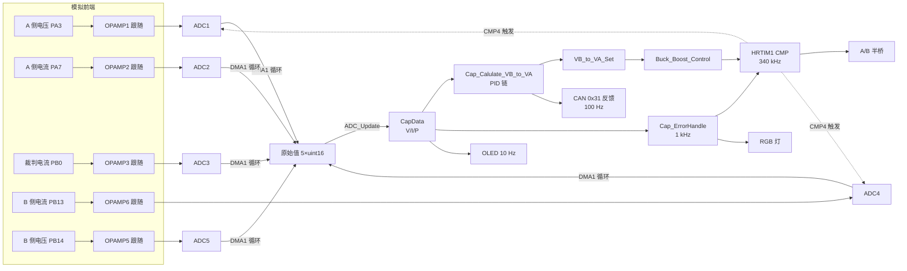

# SuperCapV3 - Mini 超级电容能量缓冲控制器

基于 **STM32G474RETx** 的 RoboMaster 超级电容（能量缓冲）控制板固件。板卡以 **HRTIM 驱动的四开关 Buck-Boost** 为核心，实时采样底盘侧与电容侧的电压/电流，通过多环 PID 计算目标充放电功率并换算为 Buck-Boost 变压比，从而在底盘功率受限时用超级电容"削峰填谷"，把裁判系统功率压在允许范围内。

> 本仓库为 **Mini 版**（`SuperCapV3 - Mini`），当前固件工作在 **受控模式（Controlled Mode）**：使能、允许功率、缓冲能量均由上位机（主控/裁判系统桥接板）通过 CAN `0x30` 或 UART 控制帧下发，超电按帧指令做功率补偿，并每 100 ms 回传 `0x31` 反馈帧。
>
> 代码中保留了编译期开关 `IF_USED_AS_BAT_BUFFER`：置 `0` 为受控模式（当前），置 `1` 退化为"电池缓冲（Battery Buffer）"模式——固定从底盘侧取 100 W，无需任何控制帧即可独立运行，适合单板离线测试。

---

## 目录

- [1. 主要特性](#1-主要特性)
- [2. 硬件平台](#2-硬件平台)
- [3. 引脚与外设分配](#3-引脚与外设分配)
- [4. 目录结构](#4-目录结构)
- [5. 系统架构与数据流](#5-系统架构与数据流)
- [6. 控制原理](#6-控制原理)
- [7. 关键参数](#7-关键参数)
- [8. 运行流程](#8-运行流程)
- [9. 通信协议](#9-通信协议)
- [10. 采样与标定](#10-采样与标定)
- [11. 编译与烧录](#11-编译与烧录)
- [12. 调试与观测](#12-调试与观测)
- [13. 设计说明与已知问题](#13-设计说明与已知问题)
- [14. 二次开发指南](#14-二次开发指南)

---

## 1. 主要特性

| 特性 | 说明 |
| --- | --- |
| 主控 | STM32G474RETx（Cortex-M4F，170 MHz，128 KB SRAM） |
| 功率拓扑 | 双半桥四开关 Buck-Boost（A 侧 / B 侧各一个半桥） |
| PWM | HRTIM1，开关频率 **340 kHz**，硬件死区，ADC 触发与 PWM 同步 |
| 采样 | 5 路运放跟随 + 5 路 ADC，DMA 循环搬运，12 bit |
| 控制 | 5 个增量式 PID（功率外环 / 电容电压上下限 / 功率内环 / 缓冲能量） |
| 工作模式 | **受控模式**（CAN/UART 控制帧生效）；编译期可切电池缓冲模式 |
| 保护 | 底盘掉电、过压、过流（预留）、通信超时、故障恢复与自复位 |
| 通信 | FDCAN2（1 Mbps，0x30/0x31）、USART2（115200，8 字节帧） |
| 人机接口 | SSD1306 OLED（I2C1，128×64）+ RGB 状态灯 |
| 板级标定 | 按 MCU 96 bit UID 自动加载电压/电流校准系数（已标定 11 块板） |

---

## 2. 硬件平台

### 2.1 时钟树

| 项目 | 配置 |
| --- | --- |
| HSE | 12 MHz 外部晶振（PF0/PF1） |
| PLL | M=3，N=85，P/Q/R=2 |
| SYSCLK / HCLK / PCLK1 / PCLK2 | 170 MHz（VOS = Scale1 Boost，Flash 4 WS） |
| ADC 时钟 | SYSCLK / 4 = 42.5 MHz |
| HRTIM 高分辨率时钟 | 170 MHz × 32 = **5.44 GHz**（184 ps 分辨率） |
| TIM6 / TIM7 计数时钟 | 170 MHz |

### 2.2 功率侧定义

- **A 侧（`A_Power_*`）**：底盘 / 电池侧，接底盘电源与裁判系统功率计。
- **B 侧（`B_Power_*`）**：超级电容组侧。
- 两侧各一个半桥（`HRTIM1` Timer A / Timer B），组成同步 Buck-Boost，可双向流动能量：

```
   底盘/电池 (A)                         超级电容组 (B)
        │                                      │
        ├── QA1/QA2 (PA8/PA9) ── L ── QB1/QB2 (PA10/PA11) ──┤
        │            ▲                         ▲            │
        └────────────┴──── 340 kHz 同步 PWM ────┴────────────┘
```

---

## 3. 引脚与外设分配

### 3.1 引脚表

| 引脚 | 功能 | 说明 |
| --- | --- | --- |
| PF0 / PF1 | HSE_IN / HSE_OUT | 12 MHz 晶振 |
| PA8 / PA9 | HRTIM1_CHA1 / CHA2 | A 侧半桥上/下管 PWM |
| PA10 / PA11 | HRTIM1_CHB1 / CHB2 | B 侧半桥上/下管 PWM |
| PA3 | OPAMP1_VINP | A 侧电压采样 |
| PA7 | OPAMP2_VINP | A 侧电流采样 |
| PB0 | OPAMP3_VINP | 裁判系统电流采样 |
| PB13 | OPAMP6_VINP | B 侧电流采样 |
| PB14 | OPAMP5_VINP | B 侧电压采样 |
| PB3 / PB4 | USART2_TX / RX | 115200 8N1，控制帧 / printf |
| PB5 / PB6 | FDCAN2_RX / TX | 1 Mbps，Classic CAN |
| PB8 / PB9 | I2C1_SCL / SDA | OLED，7 bit 地址 0x3C（8 bit 写地址 0x78） |
| PC0 / PC1 / PC2 | LED_R / G / B | **低电平点亮** |

### 3.2 外设配置

| 外设 | 配置要点 |
| --- | --- |
| ADC1–ADC5 | 12 bit，`PCLK/4`，单通道单次，`DMAContinuousRequests`，过采样关闭；ADC1–3 由 `HRTIM_TRG1`（Timer A CMP4）触发，ADC4–5 由 `HRTIM_TRG2`（Timer B CMP4）触发 |
| OPAMP1/2/3/5/6 | 高速模式，**跟随器（Follower）**，输出内部连接到对应 ADC 通道 |
| HRTIM1 | 连续模式，周期 16000，预分频 MUL32；Timer A/B 由 Master CMP1/CMP3 复位；CMP1 置位、CMP3 复位输出；死区预分频 DIV8、上升/下降各 1 个计数（≈1.5 ns，实际死区主要靠栅极驱动） |
| TIM6 | 170 MHz / 170 / 20 = **50 kHz**（中断服务目前为空，见[已知问题](#13-设计说明与已知问题)） |
| TIM7 | 170 MHz / 170 / 1000 = **1 kHz**，系统节拍（错误处理、分频任务） |
| FDCAN2 | Classic CAN，**1 Mbps**（PCLK1 170 MHz / 5 = 34 TQ），标准帧，自动重传 |
| USART2 | 115200 8N1，RX 使用 `ReceiveToIdle_DMA`（DMA1_Ch6），TX 配置 DMA1_Ch7 |
| I2C1 | 快速模式+，`Timing = 0x4052060F`，模拟滤波开、数字滤波 0 |
| DMA1 | Ch1–Ch5：ADC1–5（循环）；Ch6/Ch7：USART2 RX/TX；Ch8：I2C1 TX |

---

## 4. 目录结构

```
SuperCapV3 - Mini/
├── SuperCapV3.ioc              # CubeMX 工程（可重新生成代码）
├── README.md                   # 本文档
├── Core/                       # CubeMX 生成 + 板级初始化
│   ├── Inc/                    # main.h / 各外设 .h / HAL 配置
│   └── Src/
│       ├── main.c              # 入口、时钟、1 kHz 节拍回调、主控制循环
│       ├── adc.c               # 5×ADC + DMA + OPAMP 通道配置
│       ├── hrtim.c             # HRTIM 时基/比较/死区/输出配置
│       ├── fdcan.c usart.c i2c.c tim.c gpio.c opamp.c dma.c
│       └── stm32g4xx_it.c      # 中断向量
├── Program/                    # 应用层（与 CubeMX 解耦）
│   ├── SuperCap_Control.c/.h   # ★ 核心控制逻辑：功率/电压环、保护、通信解包
│   ├── ADC_Driver.c/.h         # ADC 原始值 → 工程量换算、功率计算
│   ├── ADC_Adjust.c/.h         # 按芯片 UID 的板级校准系数表
│   ├── PWM_Driver.c/.h         # 变比 → 占空比，HRTIM 比较值写入
│   ├── PID.c/.h                # 增量式 PID（输出累加 + 输出限幅，Kp/Ki/Kd）
│   ├── CAN_Driver.c/.h         # FDCAN 收发与过滤器
│   ├── USART_Driver.c/.h       # 串口接收空闲中断、printf 重定向
│   ├── LED.c/.h                # RGB 灯语
│   ├── OLED.c/.h               # SSD1306 驱动（江协科技库，I2C 硬件接口）
│   ├── OLED_Data.c/.h          # 字库/图库
│   └── DWT.c/.h                # 周期计数器，测量主循环频率
├── MDK-ARM/                    # Keil 工程
│   ├── SuperCapV3.uvprojx
│   └── SuperCapV3/SuperCapV3.sct
└── Drivers/                    # ST HAL + CMSIS（含 DSP 库）
```

> `Program/` 下的文件全部由 `main.h` 统一包含，工程只在 `MDK-ARM/SuperCapV3.uvprojx` 中登记，不参与 CubeMX 代码生成，重新生成不会丢失。

---

## 5. 系统架构与数据流



**分层**

| 层 | 文件 | 职责 |
| --- | --- | --- |
| 板级初始化 | `Core/Src/*.c` | 时钟、外设、DMA、中断（CubeMX 生成） |
| 驱动层 | `ADC_Driver`、`PWM_Driver`、`CAN_Driver`、`USART_Driver`、`OLED`、`LED`、`DWT` | 只做寄存器/外设操作，不含策略 |
| 算法层 | `PID`、`ADC_Adjust` | 通用算法与标定 |
| 应用层 | `SuperCap_Control`、`main.c` | 状态机、保护、控制策略、任务调度 |

---

## 6. 控制原理

### 6.1 目标

让底盘功率不超过裁判系统允许值：当底盘瞬时功率超过上限时，由超级电容补足差额；功率回落时再给电容回充。

当前为 **受控模式**：允许功率 `Max_Referee_P` 与使能 `Enable_Flag` 由上位机下发。控制器把 `CapData.Referee_P`（裁判系统功率）跟踪到 `Max_Referee_P − PowerBuffer_PID.Output`：功率超限时让电容放电补差，功率富余时让电容回充，同时用缓冲能量环把电容可用能量维持在 `Power_Buff_Target_Energy = 55`。

### 6.2 控制链（`Cap_Calulate_VB_to_VA`）

```
                      ┌──────────────────────────────────────────┐
   目标功率 ──▶( + )──▶│ Referee_P_PID  (Kp=1.0, Ki=0.03)         │──┐
   Max_Referee_P  ▲    └──────────────────────────────────────────┘  │
                  │                                                  ▼
                  │        ┌────────────────────────┐          ┌───────────┐
                  └────────│ PowerBuffer_PID        │◀─能量误差│ 取三者中  │
                           │ (Kp=0, Ki=0.005)       │          │ 的受限值  │
                           └────────────────────────┘          └─────┬─────┘
                                                                     │ Target_A_P
   CAP_MAX_V 25.5V ──▶ Cap_Vmax_PID (Ki=0.03) ──┐                     │
   CAP_MIN_V  8.0V ──▶ Cap_Vmin_PID (Ki=0.03) ──┴── 电压上下限夹紧 ────┤
                                                                     ▼
                                              CAP_P_PID (Kp=1e-3, Ki=1e-4)
                                              跟踪 Target_A_P ← A_Power_P
                                                                     │
                                                                     ▼
                            VB_to_VA_Set = (B_Power_V + ΔV) / A_Power_V
                                        ⇒ 限幅 [0.2, 5.0]
```

- **功率外环** `Referee_P_PID`：目标功率（`Max_Referee_P` 扣除缓冲能量环输出）与实测裁判功率之差，输出应补偿的功率。
- **缓冲能量环** `PowerBuffer_PID`（受控模式生效，每收到一帧控制数据计算一次）：把回传的剩余能量拉回 `Power_Buff_Target_Energy = 55`，输出限制在 ±10，用于在能量充裕时少取电、能量不足时多取电；电容电压达到 25.5 V 时输出清零。
- **电压限幅环** `Cap_Vmax/Vmin_PID`：电容电压接近 25.5 V 时压低充电功率，接近 8 V 时限制放电功率，二者与功率环输出取"最保守值"。
- **功率内环** `CAP_P_PID`：把目标功率转换为电压修正量 `ΔV`，叠加到电容电压上再除以 A 侧电压，得到变比。
- **低电量处理**：`B_Power_V < 6 V` 置 `Cap_Empty_Flag`，强制以 **30 W** 恒功率预充电，回到 `> 9 V` 后退出。
- **电流/功率上限**：`A_P_Max = min(MAX_B_Current × B_Power_V, MAX_Power)`（受控模式 `MAX_B_Current = 14 A`），并写入三个外环的 `Output_Max`。

### 6.3 变比 → 占空比（`Buck_Boost_Control`）

| 区间 | 判据 | A 桥占空比 | B 桥占空比 |
| --- | --- | --- | --- |
| Boost | `ratio ≥ 1.25` | 0.95 | 0.95 / ratio |
| Buck | `ratio ≤ 0.8` | 0.95 × ratio | 0.95 |
| 过渡 | `0.8 < ratio < 1.25` | `4/9 × (1+ratio) × 0.95` | `4/9 × (1+1/ratio) × 0.95` |

占空比最终被夹在 `[0.05, 0.95]`，写入 `CMP3 = duty × 16000`，`CMP4 = duty × 8000 + 8000`（CMP4 同时作为 ADC 触发源）。

### 6.4 保护逻辑（`Cap_ErrorHandle`，1 kHz）

| 故障 | 判据 | 动作 | 灯语 |
| --- | --- | --- | --- |
| 软件关断 | `Enable_Flag == 0`（控制帧未使能 / 通信超时） | 关 PWM | 绿灯慢闪 |
| 底盘离线 | `A_Power_V ≤ 19 V` | 关 PWM，`Connect_Error_Flag=1` | 蓝灯慢闪 |
| 过压 | `A_Power_V ≥ 32 V` 或 `B_Power_V ≥ 27 V` | 关 PWM，`V_Error_Flag=1` | 红灯常亮 |
| 过流 | 预留（已注释） | — | — |
| 正常运行 | 无故障且 `Enable_Flag=1` | 开 PWM，所有 PID 输出清零（仅首次） | RGB 同步 1 Hz 闪烁 |

恢复采用**带 1 V 回差**的判据（如 `A_Power_V ≥ 20 V` 才清底盘离线标志、`A_Power_V ≤ 31 V && B_Power_V ≤ 26 V` 才清过压标志），避免在阈值附近反复开关。

通信看门狗：100 Hz 任务每 10 ms 递增 `Communicate_Cooldown`，收到合法控制帧（CAN `0x30` 或 UART `0x55AA` 尾标）即清零；累计到 50（**500 ms 无有效帧**）就清 `Enable_Flag` 关断输出。

自复位：`Enable_Flag` 持续为 0 达 1 s 时执行 `NVIC_SystemReset()`。受控模式下这是**正常行为**——上位机不在线时，板子会以约 1 s 的周期反复复位（表现为 RGB 灯/OLED 周期性闪烁），接上控制帧即停止。

---

## 7. 关键参数

所有阈值集中在 `Program/SuperCap_Control.c` 顶部：

| 宏 | 值 | 含义 |
| --- | --- | --- |
| `IF_USED_AS_BAT_BUFFER` | **0** | 0 = 受控模式（**当前**，CAN/UART 帧生效）；1 = 电池缓冲模式 |
| `Safe_RefMax_V` | 32.0 V | 底盘侧过压保护阈值 |
| `Safe_CupMax_V` | 27.0 V | 电容侧过压保护阈值 |
| `CAP_MAX_V` | 25.5 V | 电容充电上限（闭环） |
| `CAP_MIN_V` | 8.0 V | 电容放电下限（闭环） |
| `Power_Buff_Target_Energy` | 55 | 期望缓冲能量（受控模式） |
| `MAX_B_Current` | 14.0 A | 电容最大充放电电流（受控模式；buffer 模式为 20 A） |
| `MAX_Power` | 360.0 W | 电容最大充放电功率 |
| `Chassis_Offline_V` | 19.0 V | 底盘离线判据（受控模式；buffer 模式为 14 V） |
| `Bat_Buffer_P` | 100.0 W | 仅 buffer 模式定义并使用的恒定取用功率 |

PID 参数（`Cap_Init`）：

| PID | Kp | Ki | Kd | 输出限幅 |
| --- | --- | --- | --- | --- |
| `PowerBuffer_PID` | 0 | 0.005 | 0 | 10 |
| `Referee_P_PID` | 1.0 | 0.03 | 0 | `A_P_Max` |
| `Cap_Vmax_PID` | 0 | 0.03 | 0 | `A_P_Max` |
| `Cap_Vmin_PID` | 0 | 0.03 | 0 | `A_P_Max` |
| `CAP_P_PID` | 0.001 | 0.0001 | 0 | 23.0 |

---

## 8. 运行流程

### 8.1 启动时序

```
HAL_Init → SystemClock_Config(170 MHz)
        → MX_GPIO/DMA/ADC1..5/OPAMP1,2,3,5,6/FDCAN2/HRTIM1/TIM6/TIM7/USART2/I2C1
        → HAL_Delay(300)
        → DWT_Init(170)                     // 主循环频率测量
        → Cap_Init()
             ├ ADC_Init()   : 读 UID → ADC_Adjust() 载入标定系数
             │               ADC 自校准 ×5 → 启动 5 路 DMA
             │               启动 5 个 OPAMP
             ├ OLED_Init() / LED_OFF()
             ├ HRTIM 波形计数器启动（先不开输出）
             ├ FDCAN_Init() / USART_Init()
             ├ PID_Init() ×5
             └ TIM6(50 kHz) / TIM7(1 kHz) 中断启动
        → 自检 65 次 ADC_Update() + Cap_ErrorHandle()
        → I2C 探测 OLED（写 0x00,0xAF）→ IF_OLED_Online
        → while(1) 主控制循环
             · 上电后 Enable_Flag = 0，PWM 保持关闭，等待首个控制帧
             · 1 s 内收不到有效控制帧 → NVIC_SystemReset() 重新启动
```

### 8.2 任务划分

| 频率 | 位置 | 任务 |
| --- | --- | --- |
| 自由运行（约数十 kHz） | `main` 循环 | `ADC_Update()` → `Cap_Calulate_VB_to_VA()` → `Buck_Boost_Control()`，并用 DWT 统计 `Main_Hz` |
| 1 kHz | TIM7 中断 | `Cap_ErrorHandle()`（保护、开关输出、灯语） |
| 100 Hz | TIM7 分频 | `Cap_Send_FeedBack_Data()`（发 `0x31` 反馈帧）、通信超时计数 |
| 10 Hz | TIM7 分频 | `LED_Flash_100ms_Loop()`、OLED 刷新 |
| 1 Hz | TIM7 分频 | 关闭状态下自复位 |

> ADC 本身由 HRTIM 在 340 kHz 触发并循环写入 DMA 缓冲，主循环读取到的是"最新一次采样值"，因此控制周期由主循环速度决定。

---

## 9. 通信协议

### 9.1 CAN（FDCAN2，1 Mbps，标准帧）

| ID | 方向 | 载荷 | 结构体 |
| --- | --- | --- | --- |
| `0x30` | 接收 | 3 字节 | `SuperCap_Control_Data_StructTypedef` |
| `0x31` | 发送 | 7 字节 | `SuperCap_FeedBack_Data_StructTypedef` |

```c
/* 控制帧（0x30），__packed */
uint8_t Enable_Flag;          // 超电使能
uint8_t Power_Buff_Energy;    // 当前缓冲能量
uint8_t Max_Referee_P;        // 允许的裁判系统功率

/* 反馈帧（0x31），__packed，7 字节 */
uint8_t  State;               // 开关状态
uint16_t SuperCap_V_x100;     // 电容电压 ×100
uint16_t Referee_P_x10;       // 裁判功率 ×10（负值截 0）
uint16_t Chassis_P_x10;       // 底盘功率 ×10（负值截 0）
```

过滤器：标准帧 0x00–0x7FF 全部进 FIFO0，远程帧拒收。

### 9.2 UART（USART2，115200 8N1）

固定 8 字节帧，空闲中断（`HAL_UARTEx_RxEventCallback`）收齐后校验尾部 `0x55 0xAA`（`Data[6]=0x55`、`Data[7]=0xAA`），前 3 字节与 CAN 控制帧结构相同。

> 两种链路共用 `Cap_Unpack_Control_Data()`，命中后清零 `Communicate_Cooldown`。

### 9.3 当前模式下的行为

`IF_USED_AS_BAT_BUFFER == 0`（受控模式，**当前**）时：

- `Cap_Unpack_Control_Data()` 与 `Cap_Send_FeedBack_Data()` **正常编译**：CAN `0x30` / UART 帧生效，`0x31` 反馈帧每 100 ms 发出一次；
- 上电 `Enable_Flag = 0`、`Max_Referee_P = 20 W`、`Power_Buff_Energy = 55`（`Cap_Init` 中的初值），PWM 关闭；收到**首个**带 `Enable_Flag = 1` 的控制帧后才开始输出；
- 每收到一帧即计算一次 `PowerBuffer_PID`（`Target = 55`），用于修正目标功率；`B_Power_V ≥ 25.5 V` 时其输出强制清零；
- 500 ms 未收到有效帧 → 清 `Enable_Flag` 关 PWM；再持续 1 s → 芯片复位。因此**上位机必须保持 ≥ 2 Hz 的连续发帧**，否则板子会自行关断并复位。

`IF_USED_AS_BAT_BUFFER == 1`（电池缓冲模式）时：

- 上述两个函数的**函数体被 `#if` 编译掉**，CAN/UART 控制帧不生效，`0x31` 反馈帧也不发送；
- 每轮控制强制 `Enable_Flag = 1`、`Max_Referee_P = 100 W`（`Bat_Buffer_P`）、`Power_Buff_Energy = 55`，并清零通信超时计数，因此不会触发超时关断与自复位；
- 底盘离线阈值降为 14 V、电容电流上限放宽到 20 A。

两种模式只需改 `SuperCap_Control.c` 顶部这一个宏，其余代码无需改动。

---

## 10. 采样与标定

### 10.1 换算公式（`ADC_Driver.c`）

```c
V = raw × (3.3 / 4096 × 11)  × V_Adjust      // 11 = (100k + 1k) / 1k 分压
I = (raw × 3.3 / 4096 − 1.65) × 12.5 + I_Adjust
                                            // 12.5 = 1 / (20 × 4 mΩ)，双向，1.65 V 零点
P = V × I
Chassis_P = Referee_P − A_Power_P
```

- 电压量程：0–36.3 V；电流量程：约 ±20.6 A。
- 由于使用 OPAMP 跟随器隔离阻抗，ADC 通道选择的是 `VOPAMPx` 内部通道，引脚仅作模拟输入。

### 10.2 板级校准（`ADC_Adjust.c`）

上电读取 `HAL_GetUIDw0()`，按芯片唯一 ID 匹配校准表；未命中则使用 `1.0 / 1.0 / 0` 默认值。

| UID (w0) | 备注 |
| --- | --- |
| `0x0029003D` | 0 号板 |
| `0x002C0046` | 1 号板 |
| `0x00240038` | 3 号板 |
| `0x004B0020` | 4 号板 |
| `0x00270051` / `0x00270052` | mini1 / mini2 |
| `0x0026004D` | mini3 |
| `0x00280003` | mini4 |
| `0x00210003` | mini5 |
| `0x00300003` | mini6 |
| `0x00060030` | mini7 |

新增板卡：用 `HAL_GetUIDw0()` 读出 ID，把 24 V（或 20 V）标准源下的实测值填入对应 `case` 即可。

---

## 11. 编译与烧录

### 11.1 环境

- **Keil MDK-ARM 5**（工程 `MDK-ARM/SuperCapV3.uvprojx`）
- 器件包：`Keil.STM32G4xx_DFP`
- 编译器：ARM Compiler 5/6，C99

### 11.2 工程配置

| 项 | 值 |
| --- | --- |
| Device | STM32G474RETx |
| Output | `SuperCapV3`（axf / hex） |
| 宏定义 | `USE_HAL_DRIVER, STM32G474xx, ARM_MATH_CM4, __FPU_USED=1U, __FPU_PRESENT=1U` |
| 头文件路径 | `Core/Inc`、HAL `Inc`/`Inc/Legacy`、CMSIS `Device`/`Include`、`Program` |
| 分散加载 | `SuperCapV3/SuperCapV3.sct`（Flash 0x08000000 512 KB，RAM 0x20000000 128 KB） |

### 11.3 步骤

1. 打开 `MDK-ARM/SuperCapV3.uvprojx`；
2. `Rebuild`（首次编译前确认 DFP 与 `Program/` 下的文件已加入分组）；
3. 用 ST-Link（SWD：SWDIO/SWCLK/GND/3V3）下载；
4. 复位运行，观察 RGB 灯与 OLED。

### 11.4 修改外设配置

外设改动请通过 `SuperCapV3.ioc` 在 CubeMX 中重新生成，**只修改 `USER CODE BEGIN/END` 之间的内容**，`Program/` 不受重新生成影响。

---

## 12. 调试与观测

### 12.1 OLED 界面（10 Hz 刷新）

```
RefereeP = +xx.xx      TargetP = +xx.xx
AV = +xx.xx            BV = +xx.xx
AI = +xx.xx            BI = +xx.xx
AP = +xxx.x   BP = +xxx.x
mainFre +xxxxx Hz
B/A = +x.xxx   A0.xxx  B0.xxx
```

- `mainFre`：主循环频率（DWT 实测），用来确认控制周期是否稳定；
- `B/A`：当前变比指令；`A/B`：两桥占空比；
- `TargetP`：目标取用功率；`RefereeP`：实测裁判功率。

上电时若 I2C 写 0x78 失败，则 `IF_OLED_Online = 0`，程序照常运行（不阻塞控制）。

### 12.2 串口

`printf` 已重定向到 USART2（`fputc` 阻塞发送），可临时打开 `main.c` 中被注释的调试输出：

```c
// printf("%.2f,%.2f\n", CapData.B_Power_V, CapData.Referee_P);
```

### 12.3 逻辑分析仪观测点

| 信号 | 引脚 | 预期 |
| --- | --- | --- |
| A 桥上下管 | PA8 / PA9 | 340 kHz 互补，带死区 |
| B 桥上下管 | PA10 / PA11 | 同上，占空比随变比变化 |
| CAN | PB6 | 100 Hz 反馈帧 `0x31`，同时可观测上位机下发的 `0x30` |
| 串口 | PB3 | 调试打印 |

---

## 13. 设计说明与已知问题

### 13.1 值得注意的实现细节

1. **控制环与保护解耦**：保护在 1 kHz 中断里执行，即使主循环卡死也能在 1 ms 内关断 PWM。
2. **ADC 与 PWM 同步**：ADC 由 HRTIM CMP4 触发，采样点落在开关周期内部，可避开开关噪声尖峰。
3. **变比过渡区**：0.8–1.25 之间用两桥同时调节，避免 Buck/Boost 模式切换时的占空比跳变。
4. **标定按 UID**：不同板卡的运放/分压误差在固件内补偿，量产时无需每块板改代码。

### 13.2 已知问题 / 可改进点

| 问题 | 说明 | 建议 |
| --- | --- | --- |
| `CCMRAM` 属性未真正生效 | `main.h` 用 `__attribute__((section("ccmram")))`，但 `SuperCapV3.sct` 未定义 `0x10000000` 的 CCM 区，这些函数仍被 `.ANY (+RW +RO)` 放进普通 RAM | 若确需 CCM，在 sct 中增加 `RW_IRAM2 0x10000000 0x00008000` 并显式放 `* (ccmram)` |
| TIM6 中断空转 | 50 kHz 中断服务内容被注释，仅剩中断开销 | `Cap_Init()` 中不要 `HAL_TIM_Base_Start_IT(&htim6)` |
| 串口错误回调过于粗暴 | `HAL_UART_ErrorCallback` 里 `memset(&huart2, 0, sizeof(...))` 后重建，可能丢失 DMA 句柄状态 | 改为 `HAL_UART_AbortReceive()` + 重新 `HAL_UARTEx_ReceiveToIdle_DMA()` |
| 声明未实现 | `ADC_Update_Tempture()`、`ADC_Filter()` 只在头文件声明 | 实现或删除声明 |
| 类型与语义不符 | `Power_Buff_Energy`、`Max_Referee_P` 为 `uint8_t`，却被赋 `55`、`100.0f` 这类能量/功率值 | 改为 `uint32_t`/`float` 或明确量纲 |
| 通信无校验 | CAN/UART 帧无 CRC，仅 UART 有 `0x55AA` 尾标 | 增加校验字节或序号 |
| 看门狗变量类型不一致 | `main.c` 定义为 `uint16_t Communicate_Cooldown`，`CAN_Driver.c` 却声明为 `extern uint8_t`（`USART_Driver.c`、`SuperCap_Control.c` 用的是 `uint16_t`） | 统一为 `uint16_t` 并放进公共头文件，避免不同翻译单元解释长度不同 |
| 主循环周期不定 | 控制频率依赖代码执行时间（OLED 刷屏时抖动） | 关键控制放到固定频率定时器中断或做时基补偿 |

---

## 14. 二次开发指南

### 14.1 切换工作模式

模式由 `SuperCap_Control.c` 第 3 行的宏唯一决定（当前为 **受控模式**）：

```c
/* SuperCap_Control.c:3 */
#define IF_USED_AS_BAT_BUFFER 0     // 0 = 受控模式（当前，CAN/UART 帧生效 + 0x31 反馈）
                                    // 改成 1 = 电池缓冲模式（100 W 恒功率，无需上位机）
```

切换后**必须重新编译烧录**，并同步检查各模式私有宏：

| 宏 | 受控模式（0） | 缓冲模式（1） |
| --- | --- | --- |
| `MAX_B_Current` | 14 A | 20 A |
| `Chassis_Offline_V` | 19 V | 14 V |
| `Bat_Buffer_P` | 不定义 | 100 W |

台架联调建议：

1. **先切缓冲模式**给电容预充电、验证采样与保护（无需上位机，板子不会复位）；
2. 接上主控后再切回受控模式，用 USB-CAN 以 100 Hz 发 `0x30` 帧，确认 `0x31` 有回传且 `TargetP` 跟随；
3. 受控模式下若停发帧，500 ms 后 PWM 关闭、1 s 后芯片复位，这是预期行为，不是故障。

### 14.2 调整功率上限 / 保护阈值

修改 `SuperCap_Control.c` 顶部的 `Safe_RefMax_V`、`Safe_CupMax_V`、`CAP_MAX_V`、`CAP_MIN_V`、`MAX_Power`、`MAX_B_Current`。改完务必在低压台架上先验证保护动作，再上高压。

### 14.3 整定 PID

1. 先把 `Referee_P_PID` 的 `Kp` 调小、`Ki` 置 0，观察 `Target_A_P` 对阶跃的响应；
2. 逐渐加 `Ki` 消除稳态误差；
3. 电压限幅环只在接近 25.5 V / 8 V 时起作用，可用直流源把 `B_Power_V` 拉到边界验证；
4. `CAP_P_PID` 是功率内环，带宽应明显高于外环。

### 14.4 新增板卡

1. 读取 `HAL_GetUIDw0()`；
2. 在 `ADC_Adjust.c` 的 `switch` 中新增 `case`，填入电压/电流校准系数；
3. 用标准源复测 24 V 与 0 A 零点，误差应 < 0.5%。

---

## 附：核心数据结构

```c
typedef __PACKED_STRUCT {
    float Referee_I, A_Power_V, A_Power_I, B_Power_V, B_Power_I;
    float Referee_P, Chassis_P, A_Power_P, B_Power_P;
} CapData_StructTypedef;          // 实时采样（工程量）

typedef __PACKED_STRUCT {
    uint8_t PWM_Out_Enable, Enable_Flag, Power_Buff_Energy, Max_Referee_P;
    uint8_t Cap_Empty_Flag, V_Error_Flag, I_Error_Flag, Connect_Error_Flag;
    float   Target_A_P, VB_to_VA_Set, A_Duty, B_Duty;
} CapControl_StructTypedef;       // 控制状态
```
